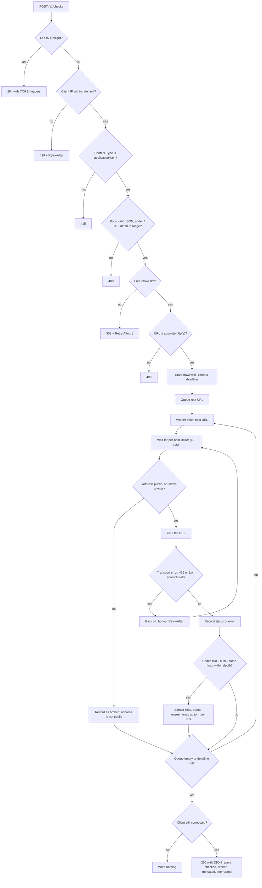

# Request flow

What `linkcheckd` does with a `POST /v1/checks` request, from arrival to response.
Flag names refer to the `linkcheckd` flags; see the README for their defaults.

Notes:

- The rate limit counts every request, valid or not.
- External links are checked but never crawled.
- Hitting the deadline is not an error: the response is still 200, with a partial report and `interrupted: true`.
